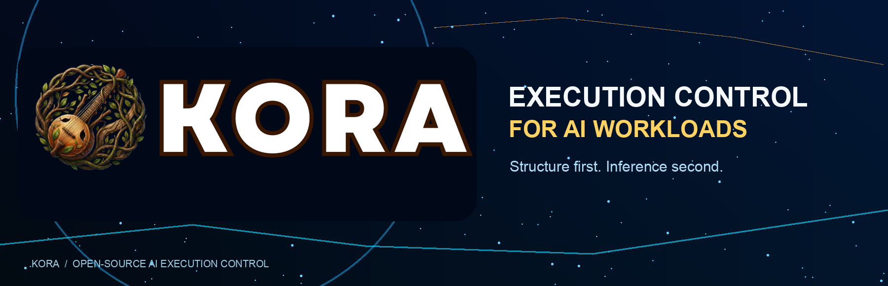
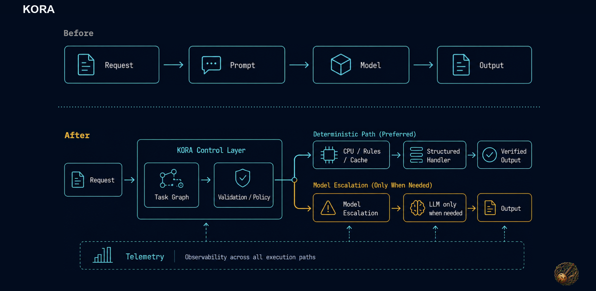

# KORA

<br />



<br />

<p align="center">
  <a href="https://github.com/Krako-Labs/KORA/actions/workflows/ci.yml"></a>
  <a href="LICENSE"></a>
  <a href="pyproject.toml"></a>
  <a href="https://arxiv.org/abs/2610.35869"></a>
</p>

<p align="center">
  <a href="https://github.com/Krako-Labs/KORA/stargazers"></a>
  <a href="https://github.com/Krako-Labs/KORA/forks"></a>
  <a href="https://github.com/Krako-Labs/KORA/issues"></a>
  <a href="https://github.com/Krako-Labs/KORA/commits/main"></a>
  <a href="https://krako.xyz/"></a>
</p>

<br />

**Most AI apps call the model too soon.**

KORA is an open-source **AI Execution Control Layer** that inspects work before inference. It routes deterministic tasks, reuses known results, and makes model escalation an explicit decision.

An open-source project from [Krako Labs](https://krako.xyz/).

**Structure first. Inference second.**

[Quick Start](#quick-start) · [How It Works](#how-it-works) · [Research Paper](#research-and-evidence) · [KORA Ecosystem](#kora-ecosystem) · [Documentation](#documentation-and-contributing)

## Contents

- [Why execution control?](#why-execution-control) — the problem KORA addresses
- [How it works](#how-it-works) — model-first versus deterministic-first
- [Quick start](#quick-start) — run a local, offline example
- [Research and evidence](#research-and-evidence) — arXiv preprint, benchmark, and limits
- [What KORA does today](#what-kora-does-today) — implemented capabilities
- [KORA ecosystem](#kora-ecosystem) — related, separately installed projects
- [Architecture and advanced guides](#architecture-and-advanced-guides) — protocol, local runtimes, and research workflow
- [Scope and limitations](#scope-and-limitations) — what the current alpha does not prove
- [Documentation and contributing](#documentation-and-contributing) — useful entry points

<br />

## Why Execution Control?

Many AI workflows send every request straight to a model—even when the work is a known rule, a repeated result, a structured lookup, or a check that ordinary code can perform.

KORA puts execution control before inference. It separates work that can be resolved or reused from work that genuinely needs model reasoning. **It does not replace models:** uncertain or novel tasks remain candidates for model escalation.

<br />

## How It Works

<br />



<br />

*How KORA Works — model-first versus deterministic-first execution.*

<br />

The diagram illustrates KORA's execution-control design. The included offline examples demonstrate bounded paths, not a production deployment or universal model-call reduction.

[Explore the detailed architecture](docs/assets/kora_workload_control_layer_architecture.svg) · [Read the architecture guide](docs/vision/kora_workload_control_layer.md)

<br />

## Quick Start

**Try KORA locally.** Requires Python **3.10+**; make sure `python3 --version` points to a supported interpreter (the default macOS Python may be older). You do not need an API key or a model download for the first example.

```bash
git clone https://github.com/Krako-Labs/KORA.git
cd KORA

python3 -m venv .venv
source .venv/bin/activate
python3 -m pip install -e .

python3 -m kora doctor examples/kora_doctor/customer_support_workload.json
```

The bundled *synthetic* customer-support example produces these checked local counters:

| Example metric | Expected |
| --- | ---: |
| Total tasks | 6 |
| Deterministic candidates | 4 |
| Provider-needed candidates | 2 |
| External provider calls actually made | 0 |

These are **example counters**, not a production cost or quality benchmark. The Doctor command in this repository is a workload-inspection example; the [standalone KORA Doctor](https://github.com/Krako-Labs/kora-doctor) is a separate CLI for agent execution traces.

**More offline examples:**

```bash
python3 -m kora proxy-demo examples/openai_compatible_proxy/requests.json
python3 examples/cache_reuse/run.py
python3 -m kora system inventory
```

**Package note:** `pip install kora` installs a different project. The planned package name `getkora` is **not published**; install this repository from source as shown above.

[First-run example details](examples/kora_doctor/README.md) · [All runnable examples](examples/README.md)

<br />

## Research and Evidence

### Research paper

**[KORA: Deterministic-First Execution Control for AI Workloads](https://arxiv.org/abs/2610.35869)**

Albert Heekwan Kim · arXiv:2610.35869 · **preprint (not peer-reviewed)**

The paper describes pre-inference execution control, deterministic and structured routes, outcome validation, telemetry, and escalation to model-candidate paths when deterministic handling is insufficient.

[Read the paper](https://arxiv.org/abs/2610.35869) · [PDF](https://arxiv.org/pdf/2610.35869) · [Research and reproducibility notes](docs/research-paper.md)

### Reproducible benchmark

> In a reproducible 100-task deterministic-heavy benchmark workload, KORA-controlled execution avoided **80 of 100 simulated model invocations** versus a naive direct baseline.

The benchmark deliberately favors deterministic work. Its **100 → 20** simulated-invocation counts do **not** measure live provider calls, production traffic, billed API cost, energy use, or broad workload performance. The paper also describes a separate synthetic customer-support local/no-network validation workload; it is not independent production evidence.

[Benchmark report and commands](docs/benchmarks/kora_benchmark_result_v1_100.md) · [Evidence boundaries](docs/claims/kora-claim-registry.md)


### Selected AI Champion 2026 evaluation results

| Evaluation | Bounded result |
| --- | --- |
| **KECB** | **2,400 → 31 actual model calls (−98.71%)**; 2,400/2,400 specified answers correct; equal-tools router ties |
| **Offline checks** | **50,000 counted checks**, including 40,000/40,000 deterministic output matches; not AI answers |
| **CacheEval** | F1 **86.9231%**, false-hit rate **4.5283%** on 2,000 items; unmatched published comparison |

**Important:** KECB used a deliberately favorable known-policy workload; its 31 calls include a historical policy-setup call, and its fourth cache arm failed a strict route check. The 50,000 checks mix distinct operations. CacheEval was not an identical-protocol or independently certified external comparison. None demonstrates production savings or broad SOTA performance.

[Evaluation methodology and limits](docs/benchmarks/ai-champion-2026-bounded-results.md)


<br />

## What KORA Does Today

| Capability | Implemented public surface |
| --- | --- |
| **Workload inspection** | Local CLI routes and reports for sample workloads |
| **Deterministic routing and reuse** | Offline classification, cache, retrieval-needed, tool-needed, and provider-needed example paths |
| **Solution Protocol v0alpha1** | Schema and integrity validation, local runtime resolution, and a bounded reference Host lifecycle |
| **Research Foundry Alpha** | Local text-layer PDF ingest, lexical retrieval, and deterministic evidence cards |
| **Optional local model adapters** | Explicitly configured, fail-closed MLX and llama.cpp execution paths |

These are different levels of implementation. An example path or bounded reference Host is **not** evidence that the entire platform is production-ready.

<br />

## KORA Ecosystem

KORA is part of the [Krako Labs ecosystem](https://krako.xyz/), alongside related open-source tools. **They are separate projects with separate install paths**, not a single fully integrated Suite release.

| Project | Use it for | Repository |
| --- | --- | --- |
| **KORA Core** | Execution-control contracts, task routing, and bounded reference execution | [Krako-Labs/KORA](https://github.com/Krako-Labs/KORA) |
| **KORA Reach** | Local task automation with conditional frontier-agent escalation | [Krako-Labs/kora-reach](https://github.com/Krako-Labs/kora-reach) |
| **KORA Doctor** | Inspect AI agent traces for potential execution waste | [Krako-Labs/kora-doctor](https://github.com/Krako-Labs/kora-doctor) |
| **AgentGate** | Verify declared completion checks and emit execution evidence | [Krako-Labs/kora-agentgate](https://github.com/Krako-Labs/kora-agentgate) |

Follow each repository's README for its actual requirements, supported integrations, and limitations.

<br />

## Architecture and Advanced Guides

For deeper use, keep the root README short and follow the focused guides:

| Guide | What it covers |
| --- | --- |
| [Solution Protocol v0alpha1](docs/solution-protocol-v0.md) | Solution manifests, policies, integrity checks, runtime selection, and Host lifecycle |
| [Solution SDK and Conformance Kit](docs/solution-sdk-conformance-kit.md) | Scaffold and validate a local Solution package |
| [Reference Solutions](examples/solutions/README.md) | Bounded local install, run, status, and result examples |
| [Research Foundry Alpha](docs/research-foundry-alpha.md) | Text-layer PDF ingest and provenance-bearing evidence cards |
| [Example catalog](examples/README.md) | Deterministic classification, proxy routing, RAG-style routing, agent workflows, and cache reuse |

The optional `mlx_local` and `llama_cpp_local` adapters require explicitly configured local runtimes and model files. They never download a model or silently fall back to a provider.

<br />

## Scope and Limitations

KORA's current public alpha evidence does **not** establish:

- production readiness, production reliability, or broad workload superiority;
- measured real-provider or API-billing savings;
- general model-output quality, factuality, or correctness of production RAG and agent flows;
- a fully OpenAI-compatible production proxy or a universal model-serving replacement;
- Research Foundry semantic retrieval, OCR, synthesis, or factuality verification;
- that the separate ecosystem tools are one fully integrated product.

Future runtime-integrated evaluation and wider workload studies require their own protocols and evidence. See the [claim registry](docs/claims/kora-claim-registry.md) and [project roadmap](ROADMAP.md).

<br />

## Documentation and Contributing

- [Documentation index](docs/README.md) — technical guides, experiments, and reports
- [Examples](examples/README.md) — start with a runnable local workload
- [Contributing](CONTRIBUTING.md) — how to participate
- [Security](SECURITY.md) — reporting security issues
- [Governance](GOVERNANCE.md) — how the project is maintained
- [Krako Labs website](https://krako.xyz/) — learn about the team and broader work

Start with a small reproducible example and share a **sanitized** workload or issue; do not post API keys, private inputs, or proprietary data.

<br />

## License

Apache License 2.0. See [LICENSE](LICENSE).
